<picture>
  <source media="(prefers-color-scheme: dark)" srcset="assets/banner-dark.gif">
  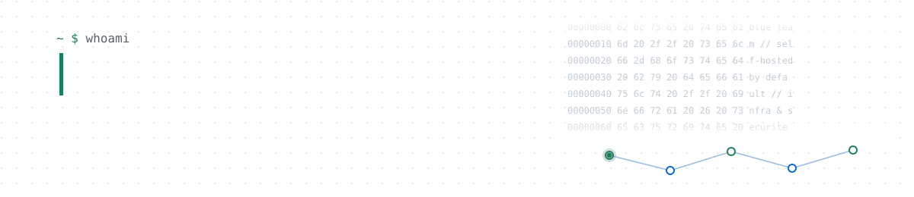
</picture>

  
  <a href="https://docs.wicatool.cc">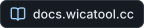</a>
  
  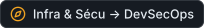

## À propos

Ingénieur systèmes & réseaux côté **Blue Team**. J'aime comprendre en profondeur ce que j'exploite plutôt que de cliquer jusqu'à ce que ça marche.

- **Sécurité par défaut** : chaque service exposé passe par un WAF, chaque accès admin par un mesh chiffré.
- **Automatisation reproductible** : Ansible, GitLab CI, infrastructure as code.
- **Des runbooks plutôt que l'intuition** pour les incidents à 2 h du matin.
- **Souveraineté d'abord** : auto-hébergé quand c'est possible, hébergeurs européens sinon.

---

## En ce moment

<table>
<tr>
<td width="50%" valign="top">

### 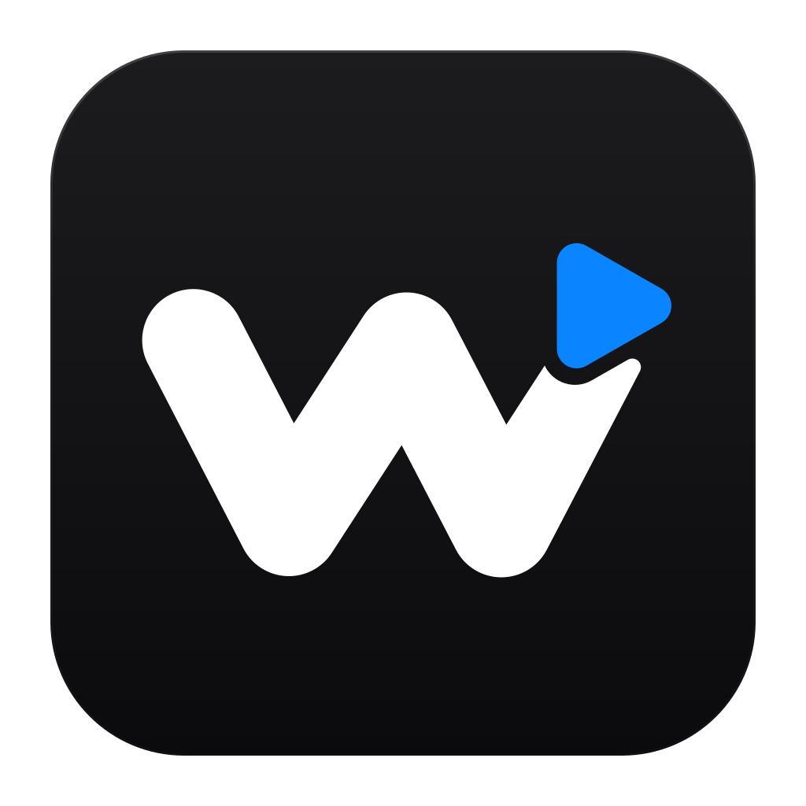 Wicaby
**Client multimédia multi-serveurs** 
[Code](https://github.com/WicaebethTheo/wicaby) · GPL-3.0

Un seul client pour **Emby, Jellyfin, Plex et Navidrome**, plus les sources **WebDAV et SMB**.

- Windows · Linux · Android · Android TV
- Bibliothèque de démo : films libres de la Blender Foundation (CC BY)
- Android : Kotlin, Jetpack Compose, Media3 · Desktop : Electron, Svelte, TypeScript

</td>
<td width="50%" valign="top">

###  Tessera
**Supervision d'infra et veille CVE, façon bureau** 
🔒 Dépôt privé · MIT

Un tableau de bord homelab qui se comporte comme un bureau : widgets sur fond d'écran, apps en fenêtres tuilées, lanceur `Ctrl+K`.

- **37 types de widgets** : Proxmox/PBS, Docker, VictoriaMetrics & VictoriaLogs, Wazuh, UniFi, NetBird, AdGuard…
- **Suivi des CVE** et des mises à jour OS, explorateur de logs en direct, PromQL, carte réseau, SLO
- **Fil d'alertes unique** : incidents, silences, maintenances, runbooks ; notifs e-mail, ntfy, Discord
- Sécurisé par défaut : rôles, CSRF, coffre chiffré pour les jetons, CSP stricte
- React · Node (Hono) · TypeScript

</td>
</tr>
</table>

---

## Projets

<table>
<tr>
<td width="50%" valign="top">

###  ITSM Modern AI
**Triage IA de tickets GLPI, auto-hébergé et souverain** 
[Site](https://itsm-modern-ai.com) · [Docs](https://docs.itsm-modern-ai.com) · [Code](https://github.com/WicaebethTheo/itsm-modern-ai) · MIT

*Le LLM propose, le code décide* : une allowlist et un seuil de confiance tranchent, et aucune action n'est appliquée sans règle déterministe et auditable.

- FastAPI · React · PostgreSQL · Alembic · architecture hexagonale
- Auth *fail-closed*, Argon2, HKDF, licences hors-ligne Ed25519
- Connecteurs OpenAI / Mistral, LLM local possible
- Modèle open-core

</td>
<td width="50%" valign="top">

### 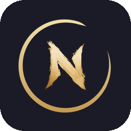 Nemesis Hub
**Plateforme communautaire Valorant** 
[nemesis-hub.com](https://nemesis-hub.com) · [Discord](https://discord.gg/Uq4MSaQBx6)

Matchmaking type FACEIT, customs 5v5, économie de points, boutique et console d'administration.

- Files, draft ou équilibrage auto, veto, MMR/Elo, classement, saisons
- Bots discord.py, API FastAPI, auth BetterAuth (OAuth Discord, RBAC), SPA React
- PostgreSQL 18, 7 stacks Docker Compose, CI/CD

</td>
</tr>
</table>

| Projet | Ce que ça fait | Stack |
|---|---|---|
| [**Homelab Dashboard**](https://github.com/WicaebethTheo/homelab-dashboard) | Proxmox, sauvegardes, SIEM et services live sur un seul écran. Config dans un fichier YAML, aucun secret en dur | React · Express · Docker |
| [**Hardening Linux**](https://github.com/WicaebethTheo/harden-linux) | Durcissement SSH multi-distro : détecte les algos dispo (`ssh -Q`), ajoute le post-quantique, **auto-revert** si l'accès est coupé | Bash · OpenSSH · `sudo-rs` |
| [**Pont RCON SCUM**](https://github.com/WicaebethTheo/DivergenceRCON) | Endpoint Source RCON : pont C++ Winsock + mod Lua via un spool protégé, administrable même serveur vide | C++ · Lua · CMake · UE4SS |
| [**Wicatool.cc**](https://docs.wicatool.cc) | Hub de documentation auto-hébergé : runbooks, procédures, outils d'admin | BookStack · DocMost |

---

## Homelab « Yggdrasil »

Deux nœuds Proxmox, un NAS, des sauvegardes hors site testées, un réseau segmenté et un SIEM. C'est mon banc d'essai : rien ne part en production sans y être passé.

| Machine | Rôle | CPU | RAM | Stockage | Réseau |
|---|---|---|---|---|---|
| **Thor** | Nœud Proxmox principal | Ryzen 9 7945HX | 96 Go DDR5 | 3 To NVMe (pool *Mjolnir*) | 10 Gb/s |
| **Freya** | Nœud Proxmox secondaire | Ryzen 9 7900X | 96 Go DDR5 | 2,5 To NVMe (pool *Gungnir*) | 2,5 Gb/s |
| **NAS** | Stockage SMB / NFS | Ryzen 9 3900X | 64 Go DDR4 | 1 To NVMe + 56 To HDD | 10 Gb/s |
| **VPS Edge** | WAF / reverse proxy public | 8 vCores | 16 Go | 512 Go NVMe | 2,5 Gb/s |
| **VPS Mesh** | Plan de contrôle NetBird | 4 vCores | 8 Go | 100 Go SSD | 1 Gb/s |
| **VPS Identité** | SSO | 4 vCores | 8 Go | 100 Go SSD | 1 Gb/s |

<b>Ce qui tourne dessus</b>

 

- **Exposition** : WAF BunkerWeb en frontal, Traefik actif/passif derrière une VIP keepalived, wildcard Let's Encrypt en DNS-01
- **Accès** : mesh NetBird auto-hébergé, SSO Authentik (OIDC/SAML), couche post-quantique Rosenpass
- **Sécurité** : Wazuh (SIEM/HIDS), CrowdSec, Trivy, PKI interne, Vaultwarden, AdGuard Home
- **Observabilité** : VictoriaMetrics, VictoriaLogs, Vector, ntfy, Tessera
- **Automatisation** : Ansible + AWX, GitLab CI, Portainer
- **Réseau** : UniFi UDM Pro SE + MikroTik CRS309, un VLAN par usage (lab, prod, IoT, invités), règles inter-VLAN explicites

---

## Stack

<table>
<tr>
<td valign="top" width="24%"><b>Virtualisation & systèmes</b></td>
<td>
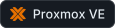
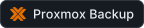

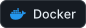
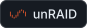
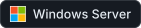
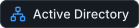
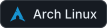
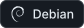
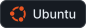

 Cluster Proxmox · sauvegardes testées · Windows Server & AD (GPO, réplication)
</td>
</tr>
<tr>
<td valign="top"><b>Réseau</b></td>
<td>

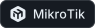
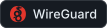

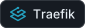
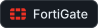

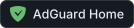
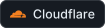
 VLAN par usage · backbone 10 G · mesh WireGuard post-quantique · HA keepalived
</td>
</tr>
<tr>
<td valign="top"><b>Blue Team</b></td>
<td>
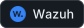
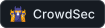

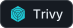
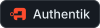
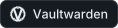
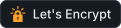
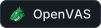
 SIEM / HIDS · WAF · PKI interne · SSO OIDC & SAML · scan de vulnérabilités · cadre NIS2
</td>
</tr>
<tr>
<td valign="top"><b>Observabilité & automatisation</b></td>
<td>
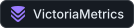
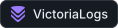
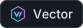
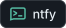
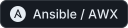

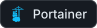
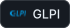
 Métriques, logs et alerting auto-hébergés · infrastructure as code · pipelines CI/CD
</td>
</tr>
<tr>
<td valign="top"><b>Reverse engineering</b></td>
<td>
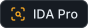
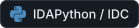
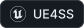
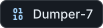
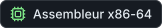
 Analyse de binaires natifs · signatures et adressage RIP-relatif · reconstruction de structures · dump de SDK Unreal Engine · mods C++/Lua
</td>
</tr>
<tr>
<td valign="top"><b>Code</b></td>
<td>
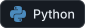
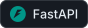
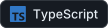
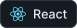

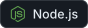
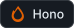
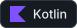

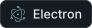
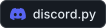
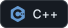
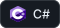

 Tests Vitest, Playwright, pytest · images publiées sur GHCR · Renovate · i18n FR/EN · accessibilité WCAG 2.2 AA
</td>
</tr>
</table>

**Poste de travail** : Omarchy (Arch) · Hyprland · Kitty · Fish · Neovim. [Dotfiles](https://github.com/WicaebethTheo/dotfiles)

---

## Ce que j'approfondis

- 🔐 **Active Directory** : durcissement, modèle de tiering, chemins d'attaque
- 🕸️ **Mesh NetBird / WireGuard** : extension entre sites
- ⚙️ **DevSecOps** : sécurisation des chaînes CI/CD et de l'infrastructure as code

---

<b>🎮 Hors infra</b>

 

Joueur ranked, et le gaming est aussi un terrain de jeu technique : Nemesis Hub, pont RCON.

| Valorant | Overwatch 2 | Apex Legends | CS2 (Faceit) | Rainbow Six Siege |
|:-:|:-:|:-:|:-:|:-:|
| Radiant | Top 500 | Master | Level 10 | Champion |

> *Low ping en ranked, faible surface d'attaque en prod.*

  Ouvert aux échanges sur l'infra, la sécurité et le self-hosting : ouvrez une issue ou passez par <a href="https://0x57696b61.com">le site</a>.

